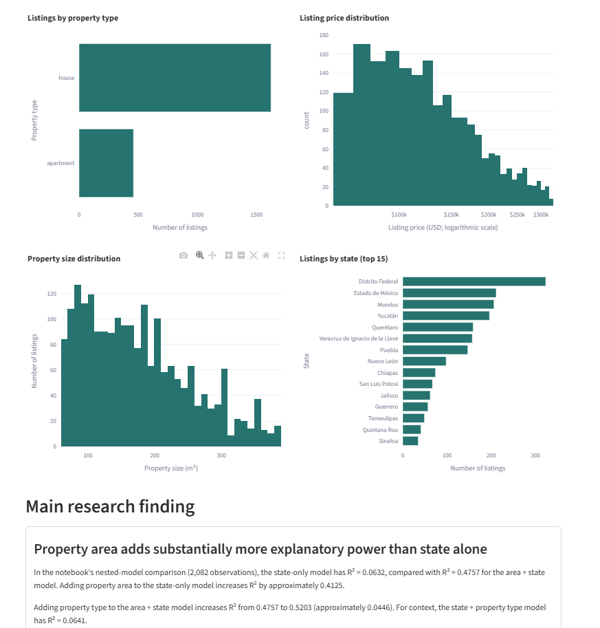
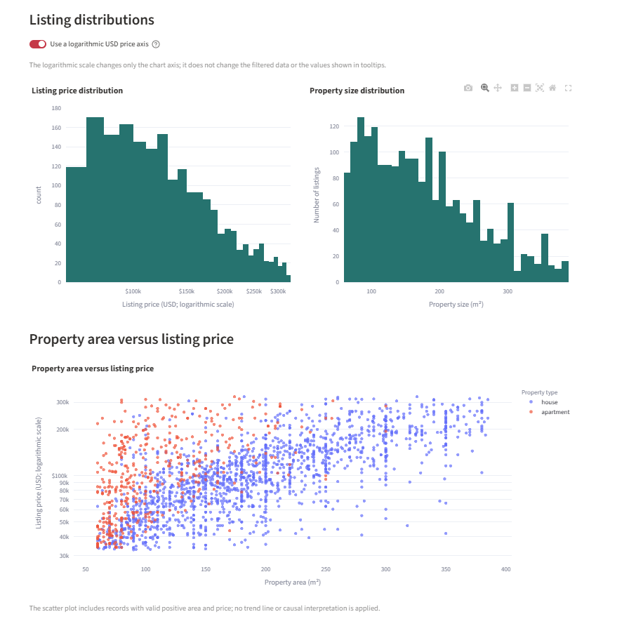
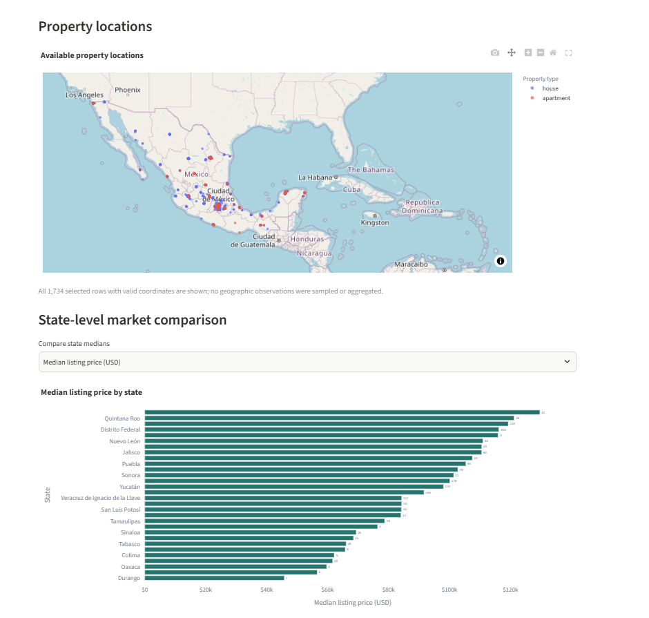
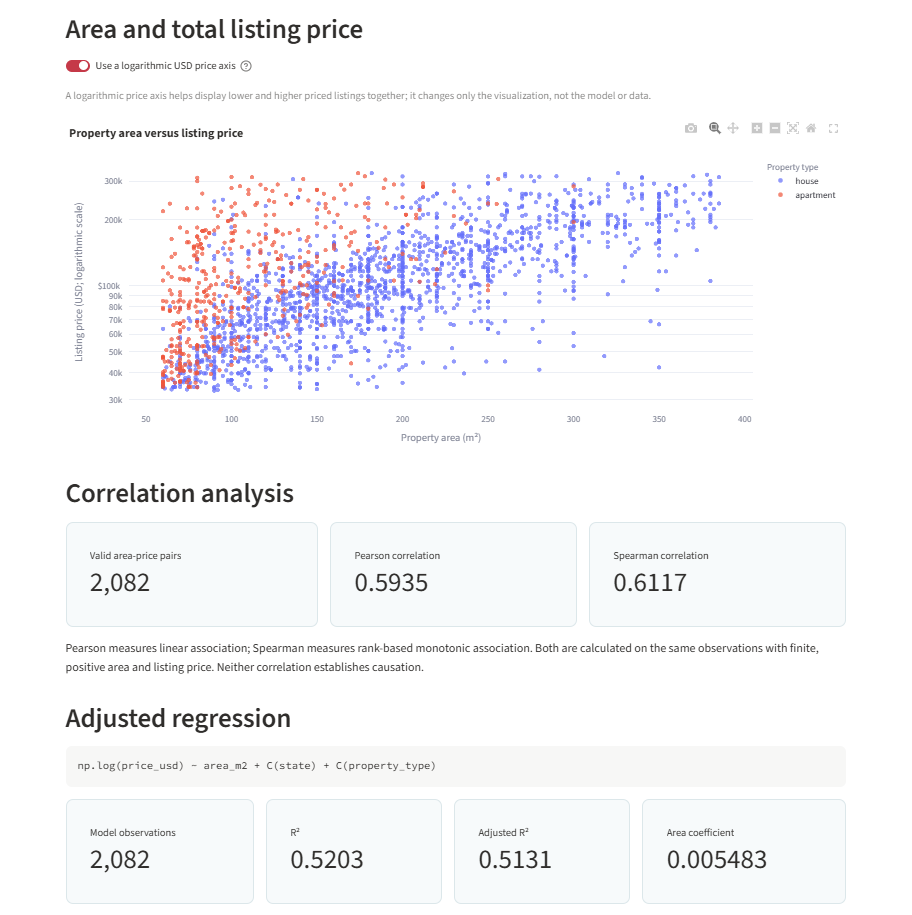
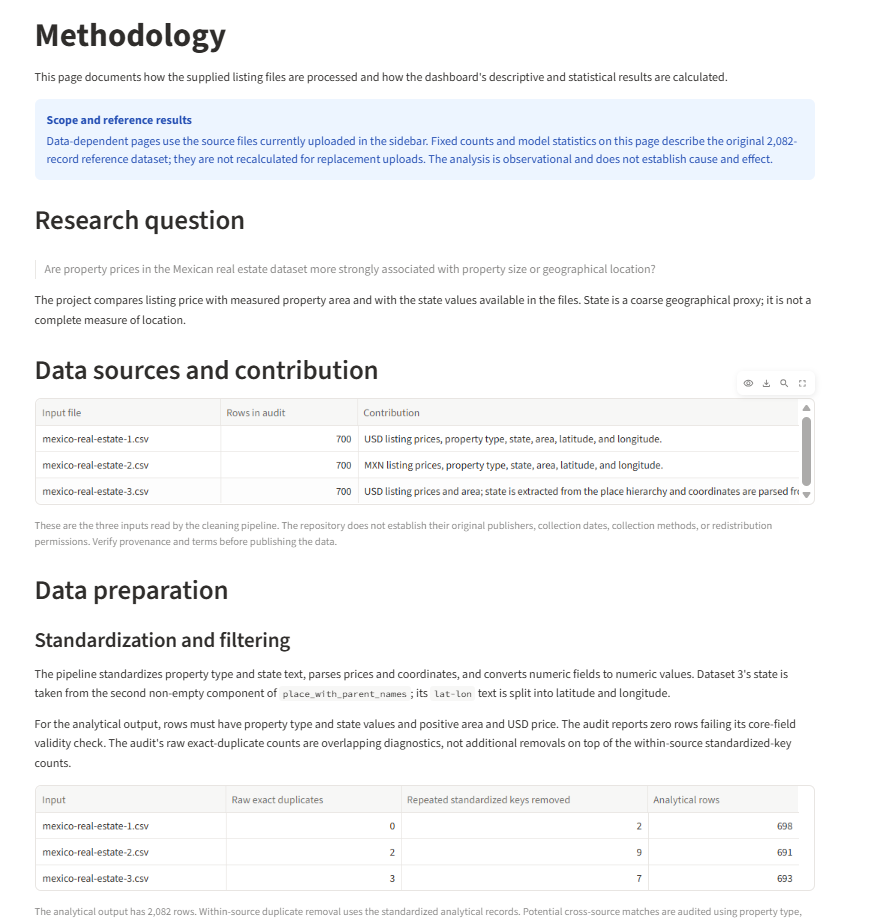

# Mexico Real Estate Insights

An observational data analysis project and Streamlit dashboard for exploring
Mexican real-estate listings, property area, listing prices, and the geographic
coverage represented by the available records. This is an analysis project, not
a property marketplace.

## Research question

> Are property prices in the Mexican real estate dataset more strongly
> associated with property size or geographical location?

The analysis compares property area and broad state categories using the
available listing data. It does not estimate causal effects, and state is only
a coarse proxy for location.

## Project objectives

- Standardize the three Mexican real-estate source files through the existing
  cleaning pipeline.
- Describe the distribution of listing prices, property sizes, property types,
  and states.
- Explore how total listing price is associated with property area.
- Compare model-based explanatory power when area, state, and property type
  terms are included.
- Disclose assumptions, data coverage, and limits on interpretation.

## Verified findings

The figures below were reproduced from the original 2,082-record reference
dataset using the project's analysis functions. They are fixed reference
results; uploaded sources are analyzed dynamically on the Price Drivers page.

- The area-price sample contains **2,082 listings**. Pearson correlation is
  **0.5935** and Spearman correlation is **0.6117**.
- The fitted model
  `log(price_usd) ~ area_m2 + C(state) + C(property_type)` has **R² = 0.5203**
  and **adjusted R² = 0.5131** on 2,082 complete observations.
- The area coefficient is **0.005483 log-price units per m²**, with HC3 robust
  standard error **0.000122** and 95% confidence interval
  **[0.005243, 0.005723]**. Its log-linear transformation is about **0.550%**
  higher fitted listing price per additional m², conditional on the included
  model terms.

| Same-sample specification | R² |
| --- | ---: |
| State only | 0.0632 |
| Area + state | 0.4757 |
| Area + state + property type | 0.5203 |
| State + property type | 0.0641 |

Adding area to the state-only specification increases R² by **0.4125**;
adding property type to the area + state specification increases R² by
**0.0446**. These are in-sample comparisons for this dataset and specification.
They do not show that area causes prices to change or that state captures all
relevant location differences.

## Dashboard screenshots

Screenshots below were captured from the working dashboard. Expand a section
to preview each page.

<details>
<summary>Market Overview</summary>



</details>

<details>
<summary>Market Explorer</summary>



</details>

<details>
<summary>Geographic Analysis</summary>



</details>

<details>
<summary>Price Drivers</summary>



</details>

<details>
<summary>Methodology</summary>



</details>

## Dashboard features

- **Home — Market Overview:** dynamic market metrics, listing distributions,
  state counts, the reference nested-model finding, and a methodological note.
- **Market Explorer:** state, property-type, area, and price filters. Metrics,
  charts, the table, and CSV export use the same filtered records.
- **Geographic Analysis:** filters over the processed coordinate dataset,
  derived from uploaded source coordinates, mapped listings, and state-level
  medians with listing counts.
- **Price Drivers:** Pearson and Spearman correlation, the HC3 regression,
  nested-model comparisons, and explicit observational caveats.
- **Methodology:** data preparation, variable definitions, statistical methods,
  verified baseline results, and limitations.

## Dataset overview

The app accepts these three source CSV inputs. The local cleaning command reads
the same files from `data/raw/`:

| Input file | Contribution |
| --- | --- |
| `mexico-real-estate-1.csv` | USD listing price, property type, state, area, latitude, longitude |
| `mexico-real-estate-2.csv` | MXN listing price, property type, state, area, latitude, longitude |
| `mexico-real-estate-3.csv` | USD listing price and area; state and coordinates are parsed from location fields |

The upload controls expect these exact source columns:

| File | Required columns |
| --- | --- |
| `mexico-real-estate-1.csv` | `property_type`, `state`, `lat`, `lon`, `area_m2`, `price_usd` |
| `mexico-real-estate-2.csv` | `property_type`, `state`, `lat`, `lon`, `area_m2`, `price_mxn` |
| `mexico-real-estate-3.csv` | `property_type`, `place_with_parent_names`, `lat-lon`, `area_m2`, `price_usd` |

The reference audit records 700 raw rows per file, 2,082 analytical rows after
within-source cleaning, and 1,734 rows in the geospatial output. Dataset 2
prices are converted using the configurable assumption of **19 MXN/USD**. The
project does not independently verify the historical validity of this rate.

The analytical output contains `source_dataset`, `property_type`, `state`,
`area_m2`, `price_usd`, `price_mxn`, `conversion_rate_mxn_per_usd`, and
`price_per_m2`. The geospatial output additionally contains `lat` and `lon`.
`price_per_m2` is calculated as `price_usd / area_m2`.

The files under `data/raw/` and `data/processed/` are excluded by
[`.gitignore`](.gitignore) and are not included in the repository. Obtain the
three source CSVs through an authorized WQU course-data source or other
authorized source; the repository does not redistribute WQU course materials.
WQU provides these course datasets; the project has not independently
established the original listing publishers, collection dates, collection
methods, or all applicable use permissions. Confirm that your use is permitted
before uploading or sharing the files.

To use the dashboard, open the shared **Dashboard data** section in the sidebar
on any page and upload each matching source CSV. The app validates the required
columns, applies the existing cleaning pipeline in memory, and derives the
geospatial dataset from the source coordinates; users do not upload processed
files. All analysis pages use the same uploaded data for the current Streamlit
session. Uploads and derived data are not written to the repository or to
`data/processed/`. On a local development copy, existing processed files may be
used as a fallback when no source files have been uploaded. For provenance,
terms, and the reference cleaning audit, see [`data/README.md`](data/README.md).

## Methodology summary

The pipeline standardizes fields, converts Dataset 2 prices from MXN, filters
for property type, state, positive area, and positive USD price, and removes
within-source duplicate standardized records. Potential cross-source matches
are reported but not removed because no unique listing identifier is available.
The geospatial file contains only records with coordinates within valid
latitude and longitude bounds.

Pearson measures linear association; Spearman measures rank-based monotonic
association. The regression uses log USD listing price with area, categorical
state, and categorical property type; HC3 robust standard errors are used for
uncertainty estimates. The four nested models use the same complete-case sample.
State-level medians are descriptive and are not adjusted for property mix.

For detailed definitions and limitations, see
[`app/pages/4_Methodology.py`](app/pages/4_Methodology.py).

## Limitations

- The listing data are observational and cannot establish causation.
- Geographic coverage is incomplete; the current geospatial file has 1,734 of
  2,082 analytical rows.
- State is a coarse location measure; neighborhood-level spatial modeling is
  not implemented.
- Source differences and the unverified Dataset 2 exchange-rate assumption may
  affect comparisons.
- The recorded values are listing prices, not verified transaction prices.
- The lack of unique listing identifiers prevents confirming physical
  cross-source duplicates.
- Price per square meter is mathematically coupled with area because area is
  its denominator.
- Regression estimates depend on the specified model and available variables.
  Property condition, age, neighborhood, and other characteristics are not
  modeled.
- The sample should not be generalized to the entire Mexican housing market
  without additional evidence.

## Technology stack

- Python (locally verified with Python 3.13)
- Streamlit
- pandas and NumPy
- Plotly
- statsmodels
- Jupyter, Matplotlib, and Seaborn for notebook-based analysis
- `unittest` and Streamlit AppTest

Dependencies are listed in [`requirements.txt`](requirements.txt). No
environment-specific paths or secrets are required by the application.

## Project structure

```text
mexican-real-estate-analysis/
├── app/
│   ├── Home.py
│   └── pages/
│       ├── 1_Market_Explorer.py
│       ├── 2_Geographic_Analysis.py
│       ├── 3_Price_Drivers.py
│       └── 4_Methodology.py
├── data/
│   ├── README.md
│   ├── raw/                         # local inputs; git-ignored
│   └── processed/                   # local outputs; git-ignored
├── docs/
│   └── screenshots/                 # dashboard page captures
├── notebooks/
├── src/
│   ├── dashboard/
│   └── real_estate_analysis.py
├── tests/
├── .gitignore
└── requirements.txt
```

## Local installation and environment

Use Python 3.13, the version verified for this project. From the repository
root, create and activate a virtual environment.

**Windows PowerShell**

```powershell
py -3.13 -m venv .venv
.\.venv\Scripts\Activate.ps1
python -m pip install -r requirements.txt
```

**macOS/Linux**

```bash
python3.13 -m venv .venv
source .venv/bin/activate
python -m pip install -r requirements.txt
```

To optionally regenerate local processed files for development, place the
three authorized Mexican input CSVs in `data/raw/` and run:

```powershell
python -m src.real_estate_analysis
```

This command writes the processed CSVs and `cleaning_audit.json` under
`data/processed/`. It cannot run from a clone until the ignored raw files have
been supplied. The dashboard upload workflow does not require this step.

## Running the dashboard

Run from the repository root:

```powershell
.\.venv\Scripts\python.exe -m streamlit run app\Home.py
```

Or, after activating the environment:

```bash
python -m streamlit run app/Home.py
```

If source CSVs have not been uploaded and local processed files are unavailable,
the sidebar explains which source files are required. Missing uploads, unreadable
CSV files, or missing schema columns produce actionable messages.

## Running tests

The test suite uses synthetic data fixtures and does not require the ignored
source CSVs:

```powershell
.\.venv\Scripts\python.exe -m unittest discover -s tests -v
```

## Streamlit Community Cloud preparation

The application can be deployed without bundling or hosting the WQU source or
processed datasets. Users must upload the three required source CSVs through
the app's sidebar for each Streamlit session. The files are sent to the app
server for in-memory processing and are not saved by the upload workflow.
Confirm that this remote processing is permitted by the applicable WQU terms
before publicly sharing the app; do not upload course files to the repository
or another public file host.

No secrets or external system packages are required. No custom
`.streamlit/config.toml` is currently needed.

1. Push only the application source and `requirements.txt` to the target
   GitHub repository and branch. Verify no raw or processed datasets are
   tracked.
2. Sign in at [Streamlit Community Cloud](https://share.streamlit.io/) and
   choose **Create app**.
3. Select the repository and branch containing the deployment-ready version.
4. Set the entrypoint to `app/Home.py`.
5. In **Advanced settings**, choose Python 3.13 to match the locally verified
   environment, then deploy. Community Cloud currently defaults to Python 3.12;
   confirm 3.13 remains available in the version selector.
6. Review the build logs and open each page after startup.

For dependency failures, compare Cloud build logs with `requirements.txt` and
the selected Python version. For data errors, check each uploaded source file
against the required columns in the Dataset overview.
Streamlit's current instructions are in the
[Community Cloud deployment guide](https://docs.streamlit.io/deploy/streamlit-community-cloud/deploy-your-app/deploy).

The application has **not** been deployed.

## Future improvements

- Verify and document source attribution, collection dates, and data
  redistribution terms.
- Replace the unresolved currency assumption with a documented, defensible
  conversion basis if the required source information becomes available.
- Obtain unique listing identifiers and richer location/property variables.
- Evaluate additional model diagnostics and more detailed spatial methods.

## Author

Daniel Abdouroihamane Ibrahim Mhadji
